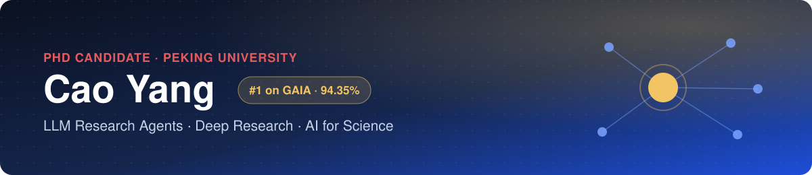

  
  
  
  
  

## About me

- 🎓 **PhD candidate at Peking University** (2025–), working on **AI for Science**.
- 🤖 **Core member of the KeenData team** — I adapt and optimize the open-source **MiroFlow** framework; the resulting **Keen AgenticOS** ranks **#1 on the [GAIA leaderboard](https://huggingface.co/spaces/gaia-benchmark/leaderboard)**.
- 🧪 Using **Bayesian optimization + LLM literature reasoning** to design CO₂-capture materials.
- 🌱 Interested in agents that are reliable, auditable and honest about what they know.

## 🏆 #1 on GAIA

[GAIA](https://huggingface.co/spaces/gaia-benchmark/leaderboard) tests general AI assistants on 301 hidden questions that need multi-step web research, file reading and reasoning.

| Submission | Overall | Level 1 | Level 2 | Level 3 | Date |
| :-- | :-: | :-: | :-: | :-: | :-: |
| **Keen AgenticOS V1.1** (KeenData) | **94.35%** 🥇 | 97.85% | 93.71% | 89.80% | Nov 3, 2026 |

## 🔬 Featured: adapting and optimizing MiroFlow for Keen AgenticOS

I adapted the open-source [MiroFlow](https://github.com/MiroMindAI/MiroFlow) research-agent framework for the KeenData team and optimized it as an **adjudicating-hub agent**: sub-agents gather evidence, and the main agent keeps every defensible candidate and decides once, at the end.

1. **Neutral orchestration** — sub-tasks ask for data, never for a pre-chosen reading of the question.
2. **Evidence-first workers** — workers return verbatim quotes, sources and archived values, not conclusions.
3. **Terminal adjudication** — candidates are compared once, from the question-writer's point of view.
4. **Traceable verdict** — the final answer is transcribed from the evidence, never re-solved.

Also: a launch gate and run guard for reliable long runs, multi-model routing (Claude · GPT · Kimi · Gemini), a deterministic output layer, and benchmark-integrity filters. → [**MiroFlow_GAIA_Keendata**](https://github.com/qingguang0309/MiroFlow_GAIA_Keendata)

## 📌 Projects

| Project | What it does |
| :-- | :-- |
| [**MiroFlow_GAIA_Keendata**](https://github.com/qingguang0309/MiroFlow_GAIA_Keendata) | Research-agent pipeline for GAIA: multi-model routing, evidence discipline, reliability gate |
| [**BO4Geopolymer**](https://github.com/qingguang0309/BO4Geopolymer) | Bayesian optimization + LLM literature reasoning for geopolymer CO₂ sorbents |
| [**BO4DAC**](https://github.com/qingguang0309/BO4DAC) | Bayesian-optimization platform that suggests sorbent formulations for direct air capture |
| [**academic-skills**](https://github.com/qingguang0309/academic-skills) | Claude skills for researchers: journal-grade figures, talk slides, manuscript polishing |
| [**minimax-h3-video-pipeline**](https://github.com/qingguang0309/minimax-h3-video-pipeline) | Storyboard → 60-second animated short in ~21 min on one RTX 4090 D |
| [**llm-from-scratch**](https://github.com/qingguang0309/llm-from-scratch-assignment1-basics) | Stanford CS336 A1: tokenizer, Transformer LM and training loop from scratch |

## 🛠 Tech stack

  
  
  
  
  
  
  
  
  

## 📊 GitHub stats

  
  

